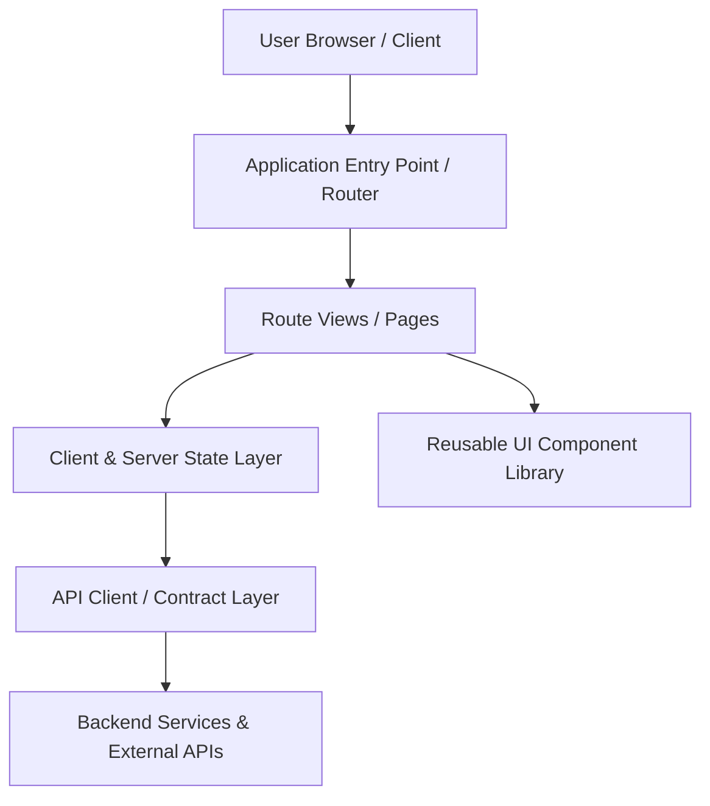

# Architecture & Mental Model

<!-- fill: 2-3 sentences explaining the frontend architecture style (e.g. Next.js App Router with server actions and TanStack Query, or Vite React SPA with Zustand and Tailwind), rendering strategy, and main external services. -->

## System Overview & Mental Model

## Entry Points & Bootstrap Sequence

<!-- fill: Real files where execution begins (root layout, index.html, main.tsx/entrypoint) and the exact bootstrap sequence. -->
1. **Entry File:** `{{path/to/entry.tsx:entry_symbol}}`
2. **Bootstrap Steps:**
   - Step 1: {{Environment and config initialization, e.g. `src/config.ts:initEnv`}}
   - Step 2: {{Global providers, auth wrappers, theme hydration, router mounting}}
   - Step 3: {{Initial data prefetch or session validation}}

## Major Modules & Responsibilities

| Module / Layer | Path | Core Responsibility | Sources of Truth | May Depend On | Must NOT Depend On |
|---|---|---|---|---|---|
| Routing / Pages | `{{src/pages/ or src/app/}}` | Route resolution, layouts, URL state | URL params | Components, State | Raw DB, Low-level sockets |
| Components | `{{src/components/}}` | Presentation, visual interaction, a11y | Props | Design tokens | Direct API calls |
| Application State | `{{src/stores/ or src/context/}}` | Client session state, UI toggles | Local storage / Memory | Utility helpers | Heavy DOM mutations |
| Server / Remote Data | `{{src/services/ or src/api/}}` | Network fetching, cache invalidation | Remote API | Contract types | UI views |
| Business Logic | `{{src/lib/ or src/utils/}}` | Pure calculations, domain rules | Invariants | Pure helpers | Framework hooks |

## Rendering Strategy & Boundaries

<!-- fill: Explain how pages render: SSR vs SSG vs Client-side SPA vs ISR.
     Where is the client/server boundary? (e.g. Next.js 'use client' directives, hydrateRoot). -->
- **Rendering Pattern:** {{e.g. Next.js Hybrid SSR + Client components / Single Page App}}
- **Client vs Server Boundary:** {{Where 'use client' or server actions are enforced}}
- **Hydration & Loading Fallbacks:** {{Suspense boundaries, Skeleton patterns}}

## Application State Ownership

| State Kind | Owner / Tool | Lifespan | Invalidation / Reset Rule |
|---|---|---|---|
| Server Cache | {{TanStack Query / SWR / Apollo}} | Session / Cache TTL | {{e.g. Invalidated on mutation in `src/api/mutations.ts`}} |
| Global UI State | {{Zustand / Redux / Context}} | Page / Tab session | {{Reset on user logout or route change}} |
| URL State | {{Query params / Router}} | Bookmarkable / History | Updated on filter/pagination changes |
| Local Form State | {{React Hook Form / Local state}} | Component lifecycle | Discarded on unmount |

## API Access & Contract Flow

<!-- fill: Explain how frontend code calls external APIs. Name the authoritative fetch wrapper or HTTP client file. -->
- **Client Wrapper:** `{{src/services/apiClient.ts:apiClient}}`
- **Authentication Injection:** {{How bearer tokens, cookies, or refresh tokens are attached and handled}}
- **Error Handling & Normalization:** {{How network errors, 401s, 403s, and 500s are caught and surfaced to the UI}}

## Business Rules & Logic Placement

<!-- fill: Where do domain validation, permissions, and business rules live?
     Ensure future agents know exactly where business calculations reside without mixing them into JSX. -->
- **Form & Input Validation:** `{{path:symbol}}`
- **Role & Permission Checks:** `{{path:symbol}}`
- **Domain Calculations:** `{{path:symbol}}`

## External Systems & Dependencies

<!-- fill: Sibling services, backend APIs, CDNs, analytics providers. -->
| External System | Purpose | Communication Contract | Location in Code |
|---|---|---|---|
| {{Main Backend}} | Primary REST/GraphQL API | [docs/CONTRACTS.md](CONTRACTS.md) | `{{src/services/...}}` |
| {{Auth Provider}} | Identity & SSO | OAuth/OIDC tokens | `{{src/auth/...}}` |
| {{Analytics}} | Telemetry & event tracking | Event schemas | `{{src/analytics/...}}` |
