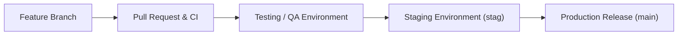

# Development & Verification Guide

<!-- fill: Verified local setup, run, build, test, and verification instructions.
     All commands here must be tested and verified against the actual repo scripts. -->

## Prerequisites & Runtime Environment

- **Node.js:** `{{v18.x / v20.x}}` (check `.nvmrc` or `package.json:engines`)
- **Package Manager:** `{{pnpm / npm / yarn / bun}}` (lockfile: `{{package-lock.json / pnpm-lock.yaml}}`)
- **Required System Tools:** `{{Docker / git}}`

## Step-by-Step Setup

1. **Clone & Install:**
   ```bash
   {{install_command: e.g. pnpm install --frozen-lockfile}}
   ```
2. **Environment Configuration:**
   Copy the sample environment file (never commit real secrets):
   ```bash
   cp .env.example .env.local
   ```
3. **Start Development Server:**
   ```bash
   {{dev_command: e.g. pnpm run dev}}
   ```
   Open `{{http://localhost:3000}}` to view the application.

## Environment Variables Reference

<!-- fill: Document all environment variables read by the frontend.
     Mark secrets. Note variables exposed to client bundles (e.g. NEXT_PUBLIC_*, VITE_*).
     RULE: Document variable names and code defaults ONLY. NEVER copy live secrets. -->
| Variable Name | Required | Client-Exposed | Default Value | Description / Where Read |
|---|---|---|---|---|
| `{{VITE_API_URL}}` | Yes | Yes | `http://localhost:8000` | Base URL for API requests (`src/config.ts:API_URL`) |
| `{{VITE_AUTH_DOMAIN}}` | Yes | Yes | — | Auth0 / Cognito domain |
| `{{SESSION_SECRET}}` | Yes (Server) | No (Secret) | — | Server session encryption key |

## Build & Preview Verification

Before opening a PR or declaring a task complete, verify the production build:
```bash
{{build_command: e.g. pnpm run build}}
{{preview_command: e.g. pnpm run preview}}
```

## Running Automated Checks & Tests

| Check Suite | Command | What It Validates |
|---|---|---|
| Type Checking | `{{pnpm run typecheck}}` | TypeScript compile errors across all files |
| Linting & Formatting | `{{pnpm run lint}}` | ESLint rules, imports, formatting |
| Unit / Component Tests | `{{pnpm run test}}` | Vitest / Jest test suites |
| End-to-End Tests | `{{pnpm run test:e2e}}` | Playwright / Cypress browser workflows |

## Safe Test-Data Guidance

<!-- fill: Instructions on how an AI agent or developer can safely test flows without modifying production data or corrupting dev databases. -->
- **Mock / Sandbox Users:**
  - Standard User: `test-user@example.com`
  - Admin User: `admin-user@example.com`
- **Seeding & Mock APIs:**
  - Mock Service Worker (MSW) or mock handlers: `{{src/mocks/handlers.ts}}`
  - Enable mock mode via `{{VITE_USE_MOCKS=true}}`.
- **Tenant Boundaries:** Always scope test objects to test tenant IDs `{{tenant_test_123}}`.

## How an Agent Checks Its Work (Verification Checklist)

Every AI agent modifying this codebase must execute the following self-verification loop:
1. **Pre-flight Baseline Check:** Run `{{typecheck_command}}` and `{{test_command}}` to verify existing baseline health before making changes.
2. **Implementation Verification:**
   - Run typechecker: `{{typecheck_command}}` (0 errors).
   - Run linter: `{{lint_command}}` (0 errors).
   - Run unit/integration tests: `{{test_command}}`.
3. **Browser & Visual Verification:**
   - Launch dev server or preview build.
   - Verify page renders correctly with no console errors or broken layouts.
   - Verify responsive behavior on mobile (375px) and desktop (1280px).
4. **Documentation Synchronization:**
   - If routes, state stores, components, or API contracts were modified, update the relevant `docs/*.md` files in the same change.
   - Run doc verifier: `python3 scripts/verify_docs.py .` (0 errors).

## PR Workflow & Deployment Pipeline

<!-- fill: The complete flow for building PRs and promoting features across environments to production.
     Always clarify this flow with the human (e.g. testing -> stag -> main). -->
### Promotion Pipeline: `testing` → `stag` → `main` (Production)



### Flow Steps
1. **Branch Creation:**
   - Create a branch from `{{main / develop}}`: `git checkout -b feature/<feature-name>` (or `fix/<bug-name>`).
   - Implement focused, reviewable changes with tests and documentation updates.
2. **Pre-PR Self-Verification:**
   - Complete the verification checklist above (typecheck, lint, test, build, doc verification).
   - Ensure clean `git status` with no temporary or scratch files.
3. **Pull Request Submission:**
   - Open a PR targeting `{{stag / main}}`.
   - Title: Use conventional commit prefix (`feat:`, `fix:`, `refactor:`, `docs:`).
   - Description: Summarize what changed, why, testing performed, and attach screenshots for UI modifications.
4. **Testing / QA Environment (`testing`):**
   - Automated CI runs build and test matrices.
   - Deployed to testing/preview environment for automated E2E suites and QA verification.
5. **Staging Environment (`stag`):**
   - Promoted to `stag` environment mimicking production data and infrastructure.
   - Final integration checks, security scans, and stakeholder approval.
6. **Production Deployment (`main`):**
   - Merged to `main` upon receiving required approvals.
   - Production deployment triggered automatically via CI/CD pipeline or release tag.
   - Post-deployment smoke verification.
