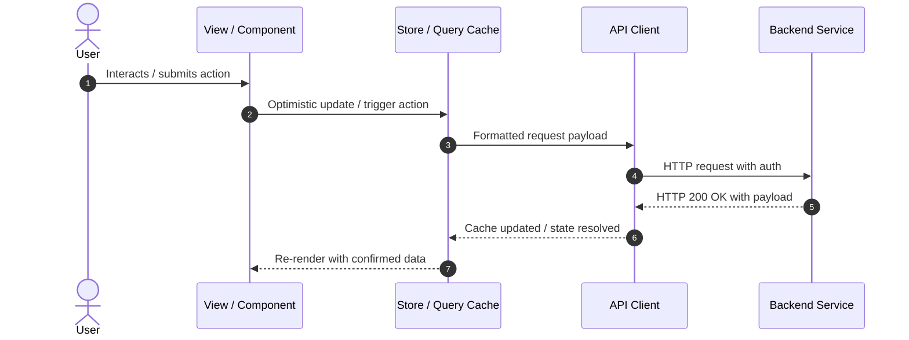

# User Flows & Critical Journeys

<!-- fill: Overview of the primary user journeys documented here. -->

## Core User Journeys Map

| Flow Name | Trigger / Starting Route | Target Outcome | Primary Route & Component |
|---|---|---|---|
| {{Flow 1: e.g. Authentication & Onboarding}} | `{{/login}}` | User dashboard ready | `{{src/pages/Login.tsx:LoginPage}}` |
| {{Flow 2: e.g. Main Workflow / Checkout}} | `{{/checkout}}` | Order confirmed | `{{src/pages/Checkout.tsx:CheckoutView}}` |
| {{Flow 3: e.g. Settings / Account Management}} | `{{/settings}}` | Preferences persisted | `{{src/pages/Settings.tsx:SettingsPage}}` |

---

## Detailed Journey: {{Primary Journey Name}}

### 1. Happy Path Sequence

### 2. Step-by-Step Path & Code Connections

1. **User Action & Route:**
   - URL: `{{/route/path}}`
   - Entry Component: `{{src/views/MyView.tsx:MyComponent}}`
   - Trigger: User clicks `{{button / form submit}}`.
2. **State & Validation:**
   - Validation schema: `{{src/lib/validation.ts:mySchema}}`
   - State transition: `{{src/stores/myStore.ts:setAction}}` sets loading status.
3. **API Dispatch:**
   - Function called: `{{src/api/myService.ts:callApi}}`
   - Request payload schema: `{{SchemaName}}` in [docs/CONTRACTS.md](CONTRACTS.md).
4. **Response & Persistence:**
   - Response handling: `{{src/api/myService.ts:handleResponse}}`
   - Local state / storage updated: `{{localStorage key or Query Cache key}}`.

### 3. Alternative Paths & Conditional Branches

- **Branch A ({{Condition A, e.g. Existing session detected}}):**
  - Evaluated in `{{path:function}}`.
  - Diverts user to `{{/alternate-route}}`.
- **Branch B ({{Condition B, e.g. Incomplete onboarding}}):**
  - Redirects to `{{/wizard}}` with query params `{{?step=2}}`.

### 4. Permissions, Roles & Guard Rails

- **Required Role / Permission:** `{{e.g. admin or verified_email}}`
- **Enforcement Location:** Route guard at `{{src/routes/guards.tsx:AuthGuard}}` and UI gate in `{{src/components/PermGate.tsx:PermGate}}`.
- **Unauthorized Behavior:** Redirects to `{{/unauthorized}}` or renders inline `{{AccessDeniedBanner}}`.

### 5. Failure Modes & Recovery Paths

| Failure Scenario | Where Caught | UI Feedback | Recovery / Fallback Action |
|---|---|---|---|
| Network offline | `{{src/api/client.ts:interceptError}}` | Offline toast banner | Cached data shown; background retry when online |
| 401 Unauthorized | `{{src/auth/interceptor.ts:refreshToken}}` | Silent token refresh | If refresh fails, redirect to `/login` preserving return URL |
| 422 Validation Error | `{{src/components/Form.tsx:handleError}}` | Inline form field error highlights | Focuses first invalid field for user correction |
| 500 Server Error | `{{src/components/ErrorBoundary.tsx:ErrorBoundary}}` | Friendly fallback view with Retry button | User can click Retry without losing typed state |
