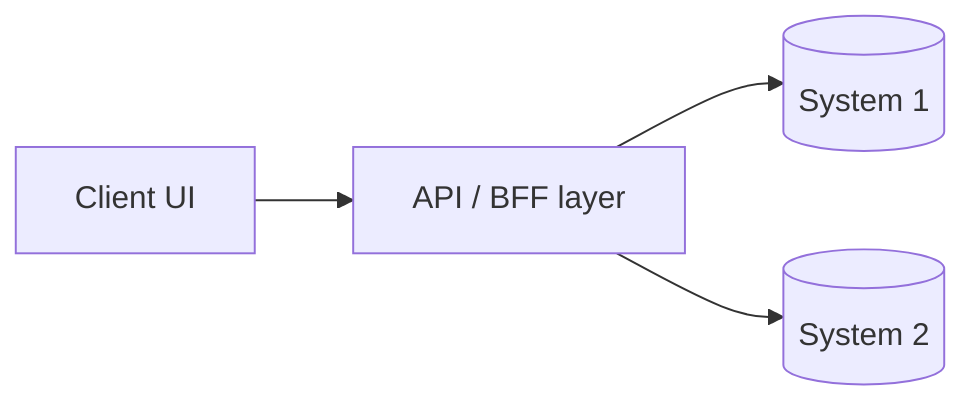

# 07 System Architecture

> This is the product-level architecture summary. The canonical deep dive is
> [`ARCHITECTURE.md`](ARCHITECTURE.md). Keep them consistent.

## Diagram
<!-- fill: an ASCII or mermaid diagram of client → API layer → backend systems. -->

## Layers
- **Client:** <!-- ... -->
- **API / BFF:** <!-- ... -->
- **Backends:** <!-- list; link to current-infrastructure/ -->

## Data Flow
<!-- fill: how a typical request travels end to end. -->
